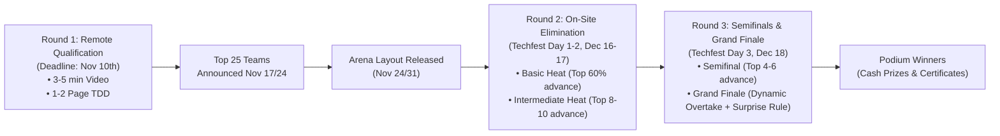

# Urban Autonomous Mobility Challenge (UAMC) — Problem Statement Analysis

## 1. Challenge Context & Background
The **Urban Autonomous Mobility Challenge (UAMC)** is organized as part of **Techfest, IIT Bombay**. Redesigned from international benchmarks such as the Bosch Future Mobility Challenge (BFMC), UAMC tests student teams on building and programming a scaled (typically 1:10 scale) autonomous vehicle capable of safely navigating a miniature urban smart-city street network without human intervention or live remote control.

### Primary Objectives:
- **Genuine Physical AI**: Real-time onboard perception, state estimation, planning, and control running on local compute (Raspberry Pi, Jetson Nano, ESP32, etc.).
- **Urban Rule Compliance**: Following marked lanes, respecting traffic lights (Red/Yellow/Green), stopping at Stop signs and pedestrian zebra crossings, negotiating roundabouts, and executing autonomous parking.
- **Dynamic Adaptability**: Handling static road obstacles, dynamic obstacles (moving vehicles/pedestrians), overtaking safely, and accommodating surprise mid-run rules in the finals.
- **Engineering Rigor**: Solutions backed by sound mathematical models, turning radius geometry, stopping distance calculations, and formal safety mechanisms.

---

## 2. Multi-Stage Competition Structure

### Round 1: Remote Qualification (Online)
- **Deadline**: November 10th.
- **Deliverables**:
  1. **Video Submission (3–5 minutes)**: Demonstrates the vehicle autonomously following a lane on a self-built practice track and making a controlled stop at an obstacle with zero remote control visible.
  2. **Technical Design Document (TDD, 1–2 pages)**: Clearly details the hardware architecture, perception stack, control algorithms, and safety E-stop mechanism.
- **Outcome**: Top 25 teams invited to IIT Bombay on-site.

### Round 2: On-Site Elimination Heats (IIT Bombay, Dec 16–17)
- **Day 1**: Check-in, technical safety inspection (E-stop verification, wiring check), and dedicated track practice slot.
- **Day 2 - Basic Heat**:
  - Lane keeping, 1 stop-sign intersection, 1 pedestrian crossing, 1 static obstacle.
  - Top 60% of teams advance.
- **Day 2 - Intermediate Heat**:
  - Adds traffic-light-controlled intersection, roundabout entry/exit, and autonomous parking bay maneuver.
  - Top 8–10 teams advance to Round 3.

### Round 3: Semifinal & Grand Finale (IIT Bombay, Dec 18)
- **Semifinal**: Full urban circuit combining all prior elements; teams ranked by composite score. Top 4–6 advance.
- **Grand Finale**: Full circuit plus dynamic obstacle avoidance / overtaking and a randomized surprise rule announced morning of Day 3 (e.g., sudden detour, closed lane).

---

## 3. Scoring System & Tactical Game Strategy

### Score Formula:
$$\text{Total Score} = \sum (\text{Task Points}) - \sum (\text{Penalties}) + \text{Bonus}$$

### Positive Scoring Tasks
| Maneuver / Task | Score Value | Strategic Focus |
| :--- | :--- | :--- |
| Full circuit completion without human intervention | **+30 points bonus** | Primary objective; reliability over speed |
| Successful safe overtake (Finals only) | **+25 points** | Requires dynamic obstacle tracking & lane-change trajectory |
| Correct traffic light stop (Red) & proceed (Green) | **+20 points** | Debounced color classification & stop line alignment |
| Correct pedestrian crossing stop | **+20 points** | Zebra pattern detection & presence verification |
| Correct stop-sign behavior (full stop + right of way) | **+15 points** | Full 3-second stationary stop before crossing |
| Correct roundabout entry & exit | **+15 points** | Curvature tracking & yield behavior |
| Successful static obstacle avoidance | **+15 points** | Early range trigger and smooth path deviation |
| Successful lane-keeping (per road segment) | **+10 points** | Continuous, smooth steering without hunting |
| Correct speed-zone compliance | **+10 points** | Sign recognition triggering governor speed limit |

### Penalty Avoidance Matrix
| Violation | Penalty | Mitigation Strategy |
| :--- | :--- | :--- |
| Illegal / unsafe overtake | **-20 points** | Strict distance thresholds and clear return lane verification |
| Collision with dynamic obstacle / vehicle | **-15 points** | Fast LiDAR / ultrasonic echo loops with proactive deceleration |
| Collision with static obstacle | **-10 points** | Multi-sensor fusion (vision bounding box + ultrasonic front array) |
| Running red light | **-10 points** | Conservative stop-line policy; assume red if uncertain |
| Failure to stop for pedestrian | **-10 points** | Stop line trigger at zebra crossing if any motion detected |
| Lane departure (wheels outside lane) | **-5 points / occurrence** | Pure pursuit lookahead tuning to prevent overshoot on tight curves |
| Missed stop sign | **-5 points** | Cascade / template sign detector at multi-scale resolutions |
| Parking outside bay lines | **-5 points** | Precise ultrasonic side-scanning & geometric alignment |
| Human intervention (touching car) | **-5 points / touch** | *Run terminated at 3rd touch!* Zero-touch autonomy priority |

---

## 4. Key Engineering Challenges & Solutions

1. **Varying Ambient Lighting**:
   - *Challenge*: On-site arena lighting at Techfest may differ from home practice tracks.
   - *Solution*: Dynamic adaptive thresholding, LAB/HSV color space transformation (isolating luminance from chrominance), and histogram equalization.

2. **Latency vs. Compute Budget**:
   - *Challenge*: Running neural nets on Raspberry Pi or Jetson Nano with high FPS.
   - *Solution*: Optimized lightweight models (MobileNet-SSD / YOLO-Fastest or classical computer vision for lane detection running at >30 FPS) combined with asynchronous multithreading.

3. **Roundabout Navigation**:
   - *Challenge*: Sharp continuous curvature where typical perspective lane trackers lose lane boundaries.
   - *Solution*: Topological state machine switching from lane tracking to curve-following with IMU heading integration and yield verification.

4. **Safety & Emergency Stop**:
   - *Challenge*: Mandatory requirement for technical inspection.
   - *Solution*: Hardwired mechanical kill switch cutting motor power + software watchdog timeout halting PWM signals if heartbeat is missed.
