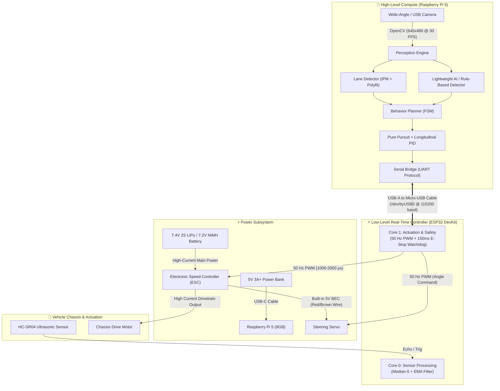
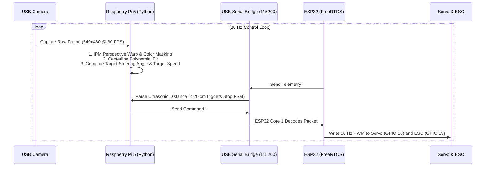

# 🏛️ Round 1 Complete System Architecture & Build Guide
### Urban Autonomous Mobility Challenge (UAMC) — Techfest, IIT Bombay
**Vehicle Model:** AML-Rover-V1  
**Target:** Round 1 Qualification (Top 25 Teams)  
**Hardware Profile:** Raspberry Pi 5 (8GB) + ESP32 DevKit v1 + 1/10 RC Chassis + ESC + Single Camera + HC-SR04  

---

## 1. Executive Summary & Objective

This document defines the complete end-to-end hardware and software architecture specifically optimized for **Round 1 of the Urban Autonomous Mobility Challenge (UAMC)**.

For Round 1, the competition demands demonstrating:
1. **Autonomous Lane Following:** Continuous centering between white/yellow road markings without crossing lane boundaries.
2. **Controlled Obstacle Halt:** Smooth deceleration and stopping before a static obstacle (> 15 cm clearance) with zero remote intervention.
3. **Safety Watchdog / E-Stop:** Demonstrable emergency stop capability.

This architecture runs **100% on the hardware you currently have in hand**, eliminating non-essential components (such as the MPU6050 IMU and Logic Level Shifter) for this stage, ensuring zero blocking dependencies.

---

## 2. End-to-End Architecture Diagram



---

## 3. Hardware Wiring & Electrical Pinout

The connection between the Raspberry Pi 5 and ESP32 DevKit is handled over a standard **USB-A to Micro-USB cable**, which handles both data communication and 5V power for the ESP32.

### A. Power Distribution Architecture
| Power Source | Consumer | Voltage / Current | Purpose |
| :--- | :--- | :--- | :--- |
| **7.4V LiPo / 7.2V NiMH Battery** | ESC Battery Input | 7.2V–7.4V nominal | High-current drive motor propulsion |
| **ESC Internal BEC** | Steering Servo | 5.0V regulated | Powers steering servo without overloading ESP32 |
| **5V 3A+ Power Bank** | Raspberry Pi 5 | 5.0V USB-C | Clean isolated power for Pi 5 compute and camera |
| **Raspberry Pi 5 USB Port** | ESP32 Micro-USB | 5.0V USB VBUS | Powers ESP32 logic and sensor rail |

### B. ESP32 Pin Connections
| Component | Signal Name | ESP32 Pin | Function / Protocol |
| :--- | :--- | :--- | :--- |
| **Steering Servo** | PWM Signal (White/Orange) | **GPIO 18** | 50 Hz PWM (`LEDC_CHANNEL_0`) |
| **Steering Servo** | Ground (Black/Brown) | **GND** | Common Ground |
| **Drive Motor ESC** | PWM Signal (White/Yellow) | **GPIO 19** | 50 Hz PWM (`LEDC_CHANNEL_1`, 1000–2000 µs) |
| **Drive Motor ESC** | Ground (Black/Brown) | **GND** | Common Ground |
| **HC-SR04 Ultrasonic** | VCC | **VIN (5V)** | Ultrasonic 5V supply |
| **HC-SR04 Ultrasonic** | GND | **GND** | Ground |
| **HC-SR04 Ultrasonic** | Trigger | **GPIO 4** | 10 µs Trigger Pulse Output |
| **HC-SR04 Ultrasonic** | Echo | **GPIO 5** | Direct Return Pulse Input (Safe for testing) |

---

## 4. Software Stack & Data Contracts



### Serial Packet Protocol
* **Raspberry Pi → ESP32 Command (`#CMD`):**
  ```text
  #CMD,<steering_normalized>,<throttle_normalized>,<estop_flag>*\n
  ```
  * `steering_normalized`: Float from `-1.0` (Full Left) to `+1.0` (Full Right).
  * `throttle_normalized`: Float from `-1.0` (Full Reverse/Brake) to `+1.0` (Full Forward).
  * `estop_flag`: Integer `0` (Normal operation) or `1` (Emergency Stop).

* **ESP32 → Raspberry Pi Telemetry (`#TEL`):**
  ```text
  #TEL,<dist_left>,<dist_center>,<dist_right>,<dist_side>,<enc_left>,<enc_right>,<yaw>,<estop>*\n
  ```
  * Distances in meters (filtered via 5-sample median filter + EMA).
  * `estop`: `1` if the 150 ms hardware watchdog triggered or hardware stop activated.

---

## 5. Step-by-Step Round 1 Bring-Up Plan

### Step 1: Upload Firmware to ESP32
1. Connect ESP32 DevKit to laptop using the Micro-USB cable.
2. Open `firmware/esp32_firmware/esp32_vehicle_controller.ino` in Arduino IDE.
3. Select Board: **ESP32 Dev Module** and correct serial port.
4. Click **Upload** and verify `Flash done`.

### Step 2: Calibrate Camera on Vehicle
1. Place vehicle on flat floor with marked lane lines ($35\text{ cm}$ apart).
2. Run camera calibration utility:
   ```bash
   python3 scripts/calibrate_camera.py --camera-id 0
   ```
3. Adjust IPM trapezoid coordinates to generate parallel lane lines in bird's-eye view. Values automatically save to `config/rpi_tuning.py`.

### Step 3: Run Full System Verification
Connect the ESP32 to the Raspberry Pi 5 USB port and execute:
```bash
python3 scripts/detect_hardware.py
python3 scripts/verify_system_ready.py
```
Verify that all 5 stages report `[PASS]`.

### Step 4: Record Qualification Video
Run the qualification telemetry video recorder:
```bash
python3 scripts/record_qualification_run.py --output-video round1_submission.mp4
```
This records real-time camera footage with superimposed steering angles, detected lane polynomials, and ultrasonic distance telemetry suitable for the Round 1 submission video.

---

## 6. Strategic Recommendations & Enhancements

### 💡 A. Recommended AI Module Selection for Round 1
| Vision Approach | Computational Load on Pi 5 | Recommendation | Rationale |
| :--- | :---: | :---: | :--- |
| **Classical CV (IPM + Polyfit)** | **~5% CPU (60+ FPS)** | 🟢 **Primary Driver** | Deterministic, highly robust on tape tracks, zero frame lag. Ideal for smooth lane tracking. |
| **YOLOv8-Nano (`models/yolov8n.onnx`)** | **~25% CPU (25–30 FPS)** | 🟡 **Optional Secondary** | Run concurrently for obstacle and sign identification. Pre-converted and verified in the repo. |
| **PilotNet (`models/pilotnet_steering.onnx`)** | **~10% CPU (45 FPS)** | ⚪ **Defer to Round 2** | Neural steering requires extensive track-specific behavioral cloning data. |

> **Best Approach for Round 1:** Use **Classical IPM Lane Detection** for primary steering and **Ultrasonic sensing** for obstacle stopping. This guarantees top-tier reliability for the qualifying video.

---

### 💡 B. Software Enhancements to Insert
1. **Auto-Start on Boot (Systemd Service):**
   * Configure a systemd service (`uamc_autostart.service`) to start `run_autonomous.py` automatically on boot when the vehicle power bank is plugged in, eliminating the need for laptop SSH during video recording.
2. **Web-Based Live Telemetry Stream:**
   * Run a lightweight MJPEG stream on port `8080` so team members can inspect the vehicle's perspective live from any smartphone connected to the Pi's Wi-Fi hotspot.

---

### 💡 C. Hardware Upgrades: Round 1 vs. Round 2 (On-Site Finals)
1. **Round 1 (Immediate - Confirmed In Hand):**
   * Raspberry Pi 5 + ESP32 DevKit v1 + USB Cable.
   * Single front HC-SR04 ultrasonic sensor.
   * Steering servo + Motor ESC + 7.4V Battery + 5V Power Bank.
2. **Round 2 (On-Site Finals at IIT Bombay):**
   * **MPU6050 IMU:** Add to ESP32 I²C bus (`SDA=GPIO 21`, `SCL=GPIO 22`) for slip compensation and yaw gyro integration.
   * **BSS138 Bidirectional Logic Level Shifter:** Place between HC-SR04 Echo pins (5V) and ESP32 GPIOs (3.3V) for long-term electrical safety.
   * **Optical Wheel Encoders:** Attach to rear drive axle for dead-reckoning odometry when crossing unmarked intersections.
